<div align="center">


**La réponse la plus rapide est celle qu'on n'a pas besoin de générer.**

<p>Une IA locale conçue pour répondre vite, avec des outils spécialisés autour de son modèle de langage.</p>

<table align="center">
  <tr>
    <td align="center"><strong>🧠 IA locale</strong><br/>Pas de GPU requis</td>
    <td align="center"><strong>⚡ Calcul vérifiable</strong><br/>Opérations prises en charge</td>
    <td align="center"><strong>🌐 Recherche ciblée</strong><br/>Sources citées dans les réponses web</td>
  </tr>
</table>

[](https://github.com/Simonc44/rontogpt/actions/workflows/tests.yml)
[](LICENSE)


<a href="https://github.com/Simonc44/rontogpt/stargazers"></a>


**Autres langues :** [English](README.md)

</div>

---

## Télécharger et lancer

**Recommandé — cloner le dépôt et lancer avec `uv` (Python 3.11+) :**

```bash
git clone https://github.com/Simonc44/rontogpt.git
cd rontogpt
uv sync
uv run python scripts/telecharger_llama.py  # télécharge le cerveau (~807 Mo) une fois
uv run rontogpt --chat
```

**Installeur Windows :** [télécharger l'archive ZIP](https://github.com/Simonc44/rontogpt/archive/refs/heads/main.zip), l'extraire, puis lancer `scripts/installer.ps1` depuis le dossier extrait.

<p align="center"><a href="https://github.com/Simonc44/rontogpt/stargazers"><strong>⭐ Ajouter une étoile à RontoGPT</strong></a></p>

<details>
<summary>Voir les particularités, l'architecture et les benchmarks</summary>

Les informations techniques détaillées sont regroupées ci-dessous.

## 💡 Pourquoi RontoGPT ?

Sur une machine sans GPU, un LLM de 1B est lent (~14 tok/s) et hallucine.
RontoGPT transforme cette faiblesse en règle de conception :

> **Le petit modèle propose. Le programme prouve.**
> Toute proposition non prouvée est vérifiée à une source ou refusée — jamais inventée.

Résultat : réponses instantanées (0–5 ms) sur 60–70 % des questions du
quotidien, maths et dates exactes, faits en temps réel, et un cerveau 1B
utilisé uniquement là où il compte.

| Mesure locale enregistrée | Résultat | Portée |
|---|---|---|
| Poids Gemma-3-1B Q4_K_M | **806 Mo** | Le fichier `.aef`, son cache extrait et les dépendances s'ajoutent au stockage total. |
| Débit de génération | **13,6–15,9 tok/s observés** | Mesure de cette machine et de ce build, pas une garantie générale. |
| Pic mémoire d'un essai récent | **~1 166 MiB RSS** | Un seul run ; varie avec le contexte, le serveur et le backend. |
| Comparaison à un 8B | **Non mesurée** | Aucune vitesse, RAM ou qualité relative n'est affirmée ici. |

### Ce que les mesures permettent de dire

| Mesure / capacité | RontoGPT actuel | Interprétation |
|---|---|---|
| Banc maison de 100 questions | **94/100** sur le dernier run enregistré | Tests mélangés : 85 points sont surtout des couches déterministes/RAG ; ce n'est pas un score de modèle général |
| GSM8K cerveau seul | **16–20 % flexible** selon le run 100 questions documenté | Le modèle local reste limité sur le raisonnement mathématique multi-étapes |
| Mémoire | Les derniers tours sont rechargés au redémarrage ; historique complet consultable | Améliore la continuité, pas les poids du modèle |
| Recherche web | DDGS par défaut ; Google Search Grounding optionnel ; liens conservés | Aide aux faits récents, sous réserve de la qualité des sources |
| Comparaison 1B / 1,5B / 3B / 8B | **Pas de banc commun complet disponible** | Aucun classement honnête face aux 3B et 8B n'est établi |

Les outils peuvent rendre RontoGPT plus exact en calcul, plus à jour sur le web,
ou plus continu en conversation. Ils ne rendent pas son LLM local aussi
capable qu'un modèle plus grand sur les tâches ouvertes. Pour comparer RontoGPT à
des modèles 1B, 1,5B, 3B et 8B, il faut les faire passer sur le même jeu
indépendant, avec cache froid, mêmes limites de temps et de contexte, et noter
qualité, latence et RAM séparément. Les résultats présents ne suffisent pas.

## 🚀 Démarrage rapide

### Une commande (Windows, PowerShell)

```powershell
powershell -ExecutionPolicy Bypass -File scripts/installer.ps1
```

Puis, dans une **nouvelle** fenêtre PowerShell :

```powershell
rontogpt "quel est le carre de 7" # -> 49
rontogpt                          # chat interactif
```

L'installeur copie le paquet dans `%LOCALAPPDATA%\RontoGPT`, crée le venv,
télécharge le cerveau (807 Mo, une seule fois) et enregistre la commande
`rontogpt` (l'alias historique `aura` reste disponible).

### Installation développeur

```bash
uv sync                                        # dépendances (llama.cpp inclus)
python scripts/telecharger_llama.py            # GGUF 807 Mo, une fois
uv run rontogpt --demo                         # démo : formule X³ + actu physique
uv run rontogpt "quelle est la capitale de la France ?"
uv run rontogpt --chat                         # chat avec mémoire
```

## 🏗️ Architecture

Le parcours détaillé d'une demande, le fonctionnement du `.aef` et les
limites des mesures sont décrits dans [le guide du flux système](docs/FLUX_SYSTEME.md).

```mermaid
flowchart TD
subgraph group_entry["Entry and orchestration"]
  node_cli["CLI and chat<br/>[__main__.py]"]
  node_orchestrator["Answer orchestrator<br/>[orchestrateur.py]"]
end
subgraph group_reason["Routing and reasoning"]
  node_fast[("Instant answers and cache")]
  node_router["Question router<br/>[routeur.py]"]
  node_pal["Dates and units<br/>[pal.py]"]
  node_symbolic["Symbolic expert"]
  node_pot["Program-of-thoughts<br/>[raisonneur.py]"]
  node_logic["Logic solver<br/>[logique.py]"]
  node_potcode["Code sandbox<br/>[potcode.py]"]
end
subgraph group_knowledge["Facts and verification"]
  node_webmemory["Web retrieval and verification<br/>[memoire_web.py]"]
  node_factgraph[("Fact graph<br/>[graphe_faits.py]")]
end
subgraph group_generation["Language generation"]
  node_agents["Cognitive agents<br/>[agents.py]"]
end
subgraph group_runtime["Model runtime"]
  node_llm["Language model interface<br/>[llama_cerveau.py]"]
  node_adapters["LoRA adapters<br/>[adaptateurs.py]"]
  node_loraserver["Multi-LoRA server<br/>[serveur_lora.py]"]
  node_kernel["Sealed package boot<br/>[kernel.py]"]
end
node_user(("User"))
node_web(("DDGS / Google Grounding optionnel"))
node_llama["llama.cpp model"]
node_aef[".aef package"]
node_user -->|"asks"| node_cli
node_cli -->|"submits question"| node_orchestrator
node_orchestrator -->|"checks first"| node_fast
node_orchestrator -->|"classifies"| node_router
node_orchestrator -->|"solves numeric tasks"| node_pal
node_orchestrator -->|"requests exact formulas"| node_symbolic
node_orchestrator -->|"checks reasoning steps"| node_pot
node_orchestrator -->|"solves constraints"| node_logic
node_orchestrator -->|"verifies code"| node_potcode
node_orchestrator -->|"structures response"| node_agents
node_orchestrator -->|"requests current facts"| node_webmemory
node_webmemory -.->|"searches"| node_web
node_orchestrator -->|"looks up facts"| node_factgraph
node_factgraph -->|"returns evidence"| node_orchestrator
node_orchestrator -->|"requests generation"| node_llm
node_llm -->|"generates with"| node_llama
node_orchestrator -.->|"swaps category adapter"| node_adapters
node_orchestrator -.->|"sets adapter weights"| node_loraserver
node_loraserver -.->|"serves model"| node_llama
node_adapters -.->|"mounts adapter"| node_llama
node_aef -.->|"boots from"| node_kernel
node_kernel -.->|"starts assistant"| node_orchestrator
click node_cli "https://github.com/simonc44/rontogpt/blob/main/aura/__main__.py"
click node_orchestrator "https://github.com/simonc44/rontogpt/blob/main/aura/orchestrateur.py"
click node_fast "https://github.com/simonc44/rontogpt/blob/main/aura/filtre_instantane.py"
click node_router "https://github.com/simonc44/rontogpt/blob/main/aura/routeur.py"
click node_pal "https://github.com/simonc44/rontogpt/blob/main/aura/pal.py"
click node_symbolic "https://github.com/simonc44/rontogpt/blob/main/aura/expert_symbolique.py"
click node_pot "https://github.com/simonc44/rontogpt/blob/main/aura/raisonneur.py"
click node_logic "https://github.com/simonc44/rontogpt/blob/main/aura/logique.py"
click node_potcode "https://github.com/simonc44/rontogpt/blob/main/aura/potcode.py"
click node_agents "https://github.com/simonc44/rontogpt/blob/main/aura/agents.py"
click node_webmemory "https://github.com/simonc44/rontogpt/blob/main/aura/memoire_web.py"
click node_factgraph "https://github.com/simonc44/rontogpt/blob/main/aura/graphe_faits.py"
click node_llm "https://github.com/simonc44/rontogpt/blob/main/aura/llama_cerveau.py"
click node_adapters "https://github.com/simonc44/rontogpt/blob/main/aura/adaptateurs.py"
click node_loraserver "https://github.com/simonc44/rontogpt/blob/main/aura/serveur_lora.py"
click node_kernel "https://github.com/simonc44/rontogpt/blob/main/aura/kernel.py"
classDef toneNeutral fill:#f8fafc,stroke:#334155,stroke-width:1.5px,color:#0f172a
classDef toneBlue fill:#dbeafe,stroke:#2563eb,stroke-width:1.5px,color:#172554
classDef toneAmber fill:#fef3c7,stroke:#d97706,stroke-width:1.5px,color:#78350f
classDef toneMint fill:#dcfce7,stroke:#16a34a,stroke-width:1.5px,color:#14532d
classDef toneRose fill:#ffe4e6,stroke:#e11d48,stroke-width:1.5px,color:#881337
classDef toneIndigo fill:#e0e7ff,stroke:#4f46e5,stroke-width:1.5px,color:#312e81
classDef toneTeal fill:#ccfbf1,stroke:#0f766e,stroke-width:1.5px,color:#134e4a
class node_cli,node_orchestrator,node_user toneBlue
class node_fast,node_router,node_pal,node_symbolic,node_pot,node_logic,node_potcode toneAmber
class node_webmemory,node_factgraph toneMint
class node_agents toneRose
class node_llm,node_adapters,node_loraserver,node_kernel,node_web,node_llama,node_aef toneIndigo
```



### Les piliers

| Pilier | Techno | Pourquoi |
|---|---|---|
| **Niveau 0** | Maths exactes via évaluateur AST sécurisé (jamais `eval()`) + cache sémantique de réponses (TF-IDF n-grammes de caractères, cosinus ≥ 0,85) | **La réponse la plus rapide est celle qu'on n'a pas besoin de générer.** Mesuré : ×3700 sur maths directes, ×7500 sur répétitions. Les questions contextuelles (« mon prénom… ») ne sont jamais mises en cache. |
| **Routeur** | TF-IDF + Régression Logistique (150 exemples) + prototypes cosinus + seuil de confiance | Classe toute question (fautes de frappe incluses) — pas de if/else codés en dur. Un routage peu confiant refuse de deviner. |
| **Cerveau** | **Gemma-3-1B-it (Q4_K_M, 806 Mo)** via llama.cpp — le GGUF `…-Heretic-Uncensored-Thinking`, architecture `gemma3` (26 couches, dim 1152, 4 têtes / 1 KV), **raisonnement natif ` thinking`** | Bon français ET anglais d'origine, et il *raisonne* au lieu de répondre à l'aveugle. Cerveau remplaçable : `AURA_GGUF=LLAMA` recharge l'ancien Llama 3.2 1B Instruct, `AURA_GGUF=MINICPM` MiniCPM5-1B. Le format de prompt n'est **pas** lu dans l'environnement — `famille()` lit l'architecture DANS le GGUF (`gguf_meta.py`) et en déduit les balises de fin de tour : `AURA_GGUF=LLAMA` est donc un vrai commutateur à une variable. |
| **Expert symbolique** | Programmation génétique (gplearn), `pow` protégée | Trouve la loi **exacte** (`mul(mul(X0,X0),X0)` pour X³) — zéro hallucination, vérifiable. |
| **Mémoire web** | DDGS par défaut ; reranking MiniLM ONNX partagé, avec repli lexical ; trois lignes de preuve au maximum | Réduit le bruit et les tokens injectés ; le reranking mesure la pertinence, pas la vérité. |

### La couche d'intelligence vérifiée (pourquoi un 1B arrête d'halluciner)

| Mécanisme | Ce que ça corrige | Comment |
|---|---|---|
| **Vérification CRITIC itérative** | réponses factuelles courtes sans contexte web | Jusqu'à deux requêtes ; la seconde cible la réponse candidate si les résultats initiaux ne la recoupent pas. Les trois meilleures lignes sont conservées avant génération ; pertinence ne signifie pas preuve de vérité. |
| **Graphe de faits** (`graphe_faits.py`) | savoir de niche hors-ligne | triplets `(sujet, relation, objet)` en JSONL, recherche par couverture multi-mots. Nourri par le corpus local et par des réponses révisées avec au moins deux liens ; des sources peuvent malgré tout être erronées |
| **PAL** (`pal.py`) | dates, unités, pourcentages composés | « 15% de 200 plus 30% de 100 » → 60, « 100 f en c », « combien de jours jusqu'au 25 décembre » — déterministe, < 1 ms |
| **Program-of-Thoughts** (`raisonneur.py`) | énigmes chiffrées | le 1B écrit des lignes `ETAPE 1/ETAPE 2`, l'AST sécurisé évalue chaque étape : « Léo a 4 ans, Marie le double, Paul 3 de plus » → **11, chaque étape vérifiée** |
| **Solveur logique** (`logique.py`) | logique sans nombres (chevaliers & menteurs, attributions) | le 1B formalise `ENTITES/DOMAINE/CONDITION`, un mini-SAT en pur Python déduit exactement ; les contraintes inventées sont détectées → repli propre |
| **PoT-code** (`potcode.py`) | génération de code cassé | le 1B écrit une fonction + des asserts, une sandbox (builtins restreints + budget d'instructions via `settrace`) exécute tout ; un assert raté = le code n'est jamais livré |
| **Agents cognitifs** (`agents.py`) | fragilité du petit modèle | agents légers qui orchestrent le 1B : planificateur (les tâches complexes sont découpées en 2-3 étapes avant rédaction), compresseur RAG (seules les 3 phrases web utiles atteignent le LLM), rédacteur (retrait des tics de langage du 1B), debugger récursif (le code raté est relancé avec l'erreur exacte de la sandbox, max 3), masqueur de personnalité (prompt système adapté à la catégorie routée). Le mimétisme few-shot et la double passe ont été **retirés avec le mode riche** — le raisonnement du modèle fait mieux le travail, et le flux le montre |
| **Hot-swap LoRA** (`adaptateurs.py`) | un cerveau, une spécialité | permutation dynamique d'adaptateurs via la C-API llama.cpp : le GGUF de base est chargé une fois, les adaptateurs par catégorie (~10-40 Mo, entraînés sur Colab avec PEFT) se montent/démontent sans recharger. Registre LRU en mémoire (défaut 1 adaptateur = empreinte quasi nulle). `AURA_ADAPTATEURS=1` pour activer |
| **Multi-LoRA servi** (`serveur_lora.py`) | un cerveau, plusieurs spécialités simultanées | le llama-server officiel (build CPU, auto-démarré par RontoGPT) monte le cerveau Q4_K_M + les 4 adaptateurs de catégorie au boot ; les probabilités du routeur deviennent des poids simultanés `{"math": 0.7, "web": 0.3}` en un appel HTTP — sans recharger, hot-swap en ~ms. Repli in-process jamais bloquant |
| **Dynamic Compute** | une seule vitesse pour tout | une question qui demande du raisonnement reçoit un budget de tokens ×2 (plancher 400) pour son bloc ` thinking` ; les simples restent instantanées. Ce raisonnement n'est **pas** retiré du flux — il est affiché, dans sa propre phase (`PHASE_PENSEE`) |
| **Mémoire à long terme** (`graphe_faits.py`) | savoir à poids égal | chaque triplet porte une force ; chaque usage **vérifié** la renforce, la recherche pondère force × récence — le savoir organise lui-même son importance, zéro réentraînement |
| **Self-play** (`selfplay.py`) | s'améliorer demande un utilisateur | un générateur de défis fabrique énigmes logiques et exercices depuis le graphe de faits, un juge déterministe valide, les succès renforcent le graphe et rejoignent le jeu d'entraînement — boucle fermée façon AlphaGo. `aura --selfplay 20` |
| **RLSS** (`rlss.py`) | auto-entraînement non validé | exercices générés → le cerveau répond → validation exacte → succès stockés pour le prochain LoRA, échecs transformés en corrections injectées |
| **Corrections durables** | retour explicite de l'utilisateur | seuil lexical plus strict pour limiter les corrections hors sujet ; reste du RAG et ne modifie pas les poids |

Pour activer Google Search Grounding, définir `AURA_GEMINI_API_KEY` dans
l'environnement avant de lancer RontoGPT. La recherche Google envoie alors la
question à Gemini ; selon l'offre et l'usage, l'API peut être payante. Sans
cette variable, RontoGPT garde son chemin DDGS habituel. Le modèle est configurable
avec `AURA_GEMINI_MODEL` (défaut `gemini-3.8-flash`).

### La pensée, en clair

Le cerveau par défaut **raisonne nativement** dans un bloc ` thinking… response`.
Ce bloc n'est plus masqué : le flux est **typé en deux phases**, donc l'utilisateur
voit le raisonnement arriver d'abord, la réponse ensuite (`PHASE_PENSEE` puis
`PHASE_REPONSE`, `llama_cerveau.py`). Un module qui n'a besoin que du résultat
final ne reçoit jamais la pensée : `generer()` renvoie toujours la réponse
seule, et le raisonnement voyage sur son propre canal (`reflexion_du_tour()`,
le journal, l'interface).

En mode de raisonnement explicite, RontoGPT limite l'historique au dernier
échange et sépare dans le prompt les extraits web, les faits vérifiés et les
formules exactes. Les exemples de style sont omis. Cela garde les preuves
disponibles pour la réponse tout en réduisant le contexte parasite ; pensée et
réponse sont toujours générées dans le même appel.

Une consigne de pensée explicite demande aussi au modèle de rester bref. Elle
ne garantit pas de raccourcir le canal natif Gemma. Les grammaires GBNF de
llama.cpp contraignent le format de sortie ; elles ne sont pas activées ici,
car le chemin Gemma ne fournit pas de séparation sûre entre pensée et réponse.

Par-dessus, le **Self-Correction Stream** (`auto_correction.py`) lit la pensée
*pendant qu'elle s'écrit* et vérifie chaque égalité arithmétique qu'il y trouve
sur des **rationnels exacts** — jamais des flottants, donc un écart d'arrondi
ne peut pas produire une fausse accusation. Une étape démontrablement fausse
coûte exactement une relance, correction injectée dans le prompt.

**L'ancien mode riche a été supprimé** (`generer_riche`, la grammaire de plan,
`contrats.py`, le pipeline par sections) : c'était un second générateur qui
contredisait le raisonnement du modèle, et c'est lui qui rendait les réponses
longues lentes. Coût de la version actuelle : la pensée défile aussi, donc une
longue réflexion est du temps *visible* plutôt que caché.

## 🎓 Entraîner son IA

RontoGPT s'améliore par le feedback, sans réentraînement. Trois leviers, du plus
simple au plus profond :

**1. Corriger une mauvaise réponse** — stockée et injectée dans les futurs prompts :

```python
from aura import autoamelioration
autoamelioration.enregistrer_correction(
    "quel est le carre de 5", "20",   # sa mauvaise réponse
    "25",                             # la bonne
    "math")
```

**2. Nourrir le graphe de faits** — les faits locaux choisis et les réponses
web révisées avec au moins deux liens peuvent l'alimenter ; ajoute aussi des
faits choisis explicitement :

```python
from aura import graphe_faits
graphe_faits.ajouter("Canberra", "est la capitale de", "l'Australie",
                     source="manuel")
```

Ou en masse : `python scripts/nourrir_graphe.py knowledge.jsonl`
(les entrées « identité » sont écartées, santé/droit marquées *info générale*).

**3. Le laisser répéter** — les réponses vérifiées rejoignent le cache
sémantique : redemande demain, la réponse revient en ~1 ms. Les entrées
fausses sont remplacées par reconsolidation (`mettre_a_jour`), jamais doublées.

> [!TIP]
> Le graphe évite les réponses sans source, mais deux liens ne prouvent pas
> qu'une affirmation est vraie. Vérifie les faits importants avant de les
> ajouter manuellement.

## 🔒 Le format `.aef` + distribution chiffrée

Tout le système tient dans **un seul fichier binaire scellé** :

```text
aura_system.aef (807 Mo, monolithique)
├── HEADER (148 o)   version, build, réglages, tailles et 3 SHA-256
├── CONFIG (LZMA)    réglages, identité/quantification du cerveau, profil forge
├── CODE (ZIP)       fichiers du paquet aura/ (pas les tests ni les caches)
└── GGUF brut        poids inchangés ; leur taille domine celle du fichier
```

La forge choisit le cerveau de `aura.toml` (`[llama].gguf`/`chemin`) ;
`AURA_GGUF` ou `AURA_GGUF_CHEMIN` peut le remplacer, et un chemin GGUF passé
en premier argument est prioritaire. Le `.aef` mémorise le nom et la famille
du cerveau embarqué. Le kernel extrait le code et le GGUF vers `.cache_aef/` ;
`llama.cpp` charge ensuite le GGUF extrait. Le fichier `.aef` reste donc sur
disque en plus du cache extrait : ce format monolithique n'économise pas une
seconde copie des poids.

**Intégrité** : la première vérification complète hache config, code et GGUF ;
`--verifier` la force à nouveau. Les démarrages rapides réutilisent les
marqueurs de validation et vérifient que le GGUF extrait correspond au
manifeste du cache. **Signature Ed25519** optionnelle.

**Un cerveau 1,5B peut être embarqué** : `R1_DISTILL` (GGUF Q4_K_M présent dans
`modeles/`, ~1,12 Go) passe dans le format sans changement de version. Le `.aef`
ne compresse pas les poids : il dépassera donc la cible stricte de 1 Go. Le
chargement estime `2,2 × taille GGUF` et refuse le démarrage si cette demande
excède 45 % de la RAM détectée. Sur 16 Go, ce contrôle passe ; sur 4 Go, le
R1 Q4 est refusé. Mesure actuelle du R1 : 51–66 s par problème GSM8K difficile,
et les LoRA Gemma fournies ne lui sont pas compatibles. Voir
[`NOTE_cerveau_raisonneur_R1.md`](resultats/gsm8k_aura/NOTE_cerveau_raisonneur_R1.md).

Le fichier chiffré `.aef.enc` est une copie supplémentaire de taille proche
du `.aef` ; la forge ne supprime pas le clair.

```bash
uv run python scripts/construire_exe.py            # -> dist/RontoGPT.exe (~8,6 Mo)
uv run python scripts/forger_aef.py --chiffrer     # -> aura_system.aef.enc (AES-256-GCM)
```

Sur la machine utilisateur (le secret livré à part, jamais dans le fichier) :

```powershell
RontoGPT.exe aura_system.aef.enc "ta question"         # déchiffre, vérifie, répond
RontoGPT.exe --cache "ta question"                      # runs suivants : démarrage instantané
```

> [!IMPORTANT]
> AES-256-GCM + PBKDF2 (600 000 itérations) : sans le secret, la charge utile
> est indistinguable d'un bruit aléatoire, et toute altération casse le
> déchiffrement. Note honnête : cela bloque la copie passive — pas un
> ingénieur inverse déterminé.

## ⚙️ Auto-tuning matériel & GPU

RontoGPT inspecte la machine (CPU, cœurs, RAM, AVX2) et dérive les réglages
optimaux :

```bash
python -m aura.profil_materiel
```

| Machine | Réglages dérivés |
|---|---|
| RAM ≥ 6 Go | ctx 4096, batch 768, threads = tous les cœurs logiques |
| RAM < 6 Go | ctx 1024, batch 512 (ajustement garanti) |

GPU : build CUDA/Vulkan + GPU dédié → offload complet ; CPU seul → 0
(optimal ici : 13,4 tok/s mesurés). Forcer le CPU avec `AURA_GPU=0`.

## 📊 Benchmarks

| Cerveau | Vitesse | Français | Chargement |
|---|---|---|---|
| **Gemma-3-1B-it** (`…-Heretic-Uncensored-Thinking`, Q4_K_M) | **13,6-15,9 tok/s** | ✅ instruction-tuned + raisonnement natif | — |
| Llama 3.2 1B Q4_K_M (défaut précédent, `AURA_GGUF=LLAMA`) | **13,4 tok/s** | ✅ instruction-tuned | 3,4 s |
| MiniCPM5-1B Q4_K_M (option, `AURA_GGUF=MINICPM`) | ~11 tok/s + tokens de réflexion | ✅ | 3,2 s |
| Qwen 2.5 1.5B (retiré) | 12,1 tok/s | ✅ | — |
| Mamba-790M / RWKV-430M (retirés) | 1,5-1,8 tok/s | ❌ modèles de base | 30-400 s |

Face-à-face au même quiz (`scripts/comparer_cerveaux.py`) : **Llama 6/7 à
3,0 s/réponse** vs **MiniCPM5 3/7 à 10,2 s/réponse** — MiniCPM5 est un cerveau
*« thinking-first »* : sans sa phase native `<think>` il sous-performe, avec
(`AURA_THINK=1`) il est 3× plus lent.

Le cerveau actuel est lui aussi *thinking-first*, et c'est tout l'intérêt du
changement : son raisonnement est **montré** (flux à deux phases) et **vérifié**
(Self-Correction Stream) au lieu d'être masqué. Limite honnête : sur une consigne
« réfléchis bien », le 1B est verbeux — 500 tokens de pensée en ~38 s, et il
peut s'égarer — d'où un budget de tokens par tour et une seule relance bornée.

**Dernier banc propre (11 oct. 2026) :** **94/100** (85/85 vérifiable,
9/15 forme) en **348 s**. Il isole la mémoire entre questions; l'ancien
98/100 n'est pas comparable, car des versions précédentes pouvaient reprendre
l'historique de conversation. Le parseur de calcul est corrigé (5/5 au format)
et les garde-fous RAG passent un jeu exploratoire de 23 questions sans faux
résultat. Les demandes longues restent le point faible (4/10 conformes dans le
dernier banc complet, jusqu'à 83 s). Voir [la référence détaillée](docs/BASELINE_2026-10-11.md).

Sur un quiz exploratoire de sept questions, Gemma obtient 5/7 en 19 s
(pic RSS : 1 165,6 MiB) et R1 4/7 en 505 s (1 870,5 MiB). Ce petit échantillon
ne permet pas de conclure à une supériorité générale. Le banc de rédaction
atteint 14/20 au critère historique de longueur sur deux répétitions ; il ne
mesure pas encore la pertinence, la couverture, l'exactitude, la structure ou
la clarté des réponses. Les [résultats détaillés](docs/BASELINE_2026-10-11.md)
décrivent le protocole et ses limites.

Un banc exploratoire commun de 28 questions est disponible pour RontoGPT, le
cerveau seul et les modèles exposés par Ollama. Exemple pour un 8B :

```powershell
uv run python scripts/benchmark_comparatif.py --bras aura,ollama `
  --modele-ollama qwen3.5:8b --rapport resultats/comparaison_8b.json
```

Répéter avec des identifiants 1B, 1,5B et 3B disponibles dans Ollama. Ce banc
compare le système RontoGPT complet à un LLM seul ; il ne prouve pas une équivalence
générale de taille. Les modèles doivent être installés localement avant l'essai.

Un quiz exploratoire ancien comparait le système à Qwen 2.5 1.5B sur cinq
questions (5/5 contre 4/5). Cet échantillon est trop petit pour conclure qu'RontoGPT
surpasse le 1,5B, et il n'existe pas ici de comparaison contrôlée avec un 3B
ou un 8B.

### Limites honnêtes

> [!NOTE]
> Les outils symboliques peuvent être plus exacts qu'un LLM seul sur les tâches
> qu'ils savent résoudre. La recherche web dépend de sources externes, et le
> modèle local conserve les limites d'un 1B en rédaction et analyse ouverte.
> Aucun niveau d'équivalence 3B/8B n'a été mesuré.

Deux contraintes supplémentaires, par conception :

- **Fenêtre de contexte 4096 tokens** — les réponses très longues (dissertations)
  peuvent être tronquées ; le mode riche sectionné (supprimé) rédigeait section
  par section pour tenir dedans, mais une dissertation de 10 pages reste hors de
  portée — et c'est désormais assumé plutôt que contourné.
- **L'historique de conversation grandit avec l'usage** — le fichier RLM est
  auto-roté (32 Mo → archive datée, 3 archives conservées) et reste
  consultable : la mémoire ne remplit jamais le disque en silence.

## 🗺 Feuille de route

- [x] Niveau 0 : maths exactes, cache sémantique, PAL
- [x] Couche d'intelligence vérifiée : CRITIC, graphe de faits, PoT, solveur logique, PoT-code
- [x] Agents cognitifs : planificateur, compresseur RAG, rédacteur, debugger récursif, masqueur de personnalité
- [x] Hot-swap LoRA dynamique : adaptateurs par catégorie montés sur le contexte vivant (C-API), registre LRU en mémoire
- [x] Format scellé `.aef` + Ed25519 + distribution chiffrée
- [x] CI verte (matrices OS/py + chaîne `.aef` + syntaxe installeur)
- [x] Multi-LoRA servi (mix de poids) + Dynamic Compute + RLSS + self-play + mémoire à long terme
- [x] ~~Mimétisme de style (few-shot) + double passe~~ — **retirés** avec le mode riche ; remplacés par le flux de pensée à deux phases + Self-Correction Stream
- [x] **Bascule du cerveau** : Llama-3.2-1B → Gemma-3-1B *Heretic-Thinking* (raisonnement natif, format de prompt lu dans le GGUF), adaptateurs Llama neutralisés par mesure
- [x] **Self-play distillant** (`scripts/selfplay_distille.py`) : paires `question → pensée → réponse` vérifiées, directement réutilisables par l'entraîneur LoRA
- [ ] **Fine-tune LoRA** sur Colab — profondeur de raisonnement, taille 807 Mo inchangée. Notebook prêt (`scripts/colab_lora_gemma.ipynb`) ; le montage lit désormais l'architecture **de l'adaptateur lui-même**, donc déposer les nouveaux `.gguf` dans `adaptateurs/` suffit — aucune constante à resynchroniser.
- [ ] **Édition de faits MEMIT** — *faisabilité d'abord.* MEMIT modifie des poids FP16 et exige des gradients plus une covariance estimée sur un corpus ; le cerveau livré est un **GGUF Q4_K_M**, non éditable sur place. Le seul chemin est une re-quantification complète sur Colab (base `unsloth/gemma-3-1b-it`), soit un tout nouveau cerveau de 806 Mo — pas le petit delta sur lequel repose la conception LoRA.
- [ ] **lm-evaluation-harness** — scores publics et comparables du cerveau
- [x] Montage LoRA automatique par architecture mesurée (famille lue dans le GGUF de l'adaptateur, jamais dans un nom ni une constante)
- [x] Auto-think sur les problèmes en mots, avec repli sans réflexion quand elle ne se referme pas
- [x] Sortie Hugging Face (`.aef` + `RontoGPT.exe` + model card)

## 🧪 Tests & qualité

```bash
uv run pytest -q        # 323 tests (CI : verte — tests dépendant du GGUF sautés, pas de GGUF en CI)
uv run mypy aura/       # 0 erreur
```

La CI (GitHub Actions) tourne sur **Ubuntu + Windows** (Python 3.11/3.12),
revalide toute la chaîne `.aef` (forge → signature Ed25519 → boot → détection
d'altération) sur Linux, et vérifie la syntaxe de l'installeur PowerShell.

## 📄 Licence

GPLv3 — voir [LICENSE](LICENSE). Copyleft : toute dérivée de l'architecture multi-agents d'RontoGPT reste open-source aux mêmes termes.

</details>
