<div align="center">


**The fastest answer is the one you never generate.**

<p>100% local, CPU-native AI system that splits language, exact math and factual
memory into specialized modules — instead of asking one small model to do
everything (and hallucinate when it can't).</p>


[](https://img.shields.io/badge/format-aef-5bc0de)
[](LICENSE)
<a href="https://github.com/Simonc44/rontogpt/stargazers"></a>

**Other languages:** [Français](README.fr.md)

</div>

---

## Get started in 60 seconds

```bash
git clone https://github.com/Simonc44/rontogpt.git
cd rontogpt
uv sync
uv run python scripts/telecharger_llama.py
uv run rontogpt --chat
```

That's it. Start talking to RontoGPT.

> **Requirements:** Python 3.11+ and [`uv`](https://docs.astral.sh/uv/).

<details>
<summary><strong>🪟 Windows installer</strong></summary>

<br>

1. [Download the source ZIP](https://github.com/Simonc44/rontogpt/archive/refs/heads/main.zip) and extract it.
2. Open PowerShell in the extracted folder.
3. Run:

```powershell
.\scripts\installer.ps1
```

</details>

<details>
<summary>Technical details, architecture, and benchmarks</summary>

The technical reference is grouped below.

## 💡 Why RontoGPT?

On a machine without GPU, a 1B LLM is slow (~14 tok/s) and hallucinates.
RontoGPT turns that weakness into a system design rule:

> **The small model proposes. The program proves.**
> Anything unproven is verified against a source or refused — never invented.

The result: instant answers (0–5 ms) on 60–70 % of everyday questions, exact
math and dates, real-time facts, and a 1B brain used only where it matters.

| Recorded local measurement | Result | Scope |
|---|---|---|
| Gemma-3-1B Q4_K_M weights | **806 MB** | The `.aef` file, its extracted cache, and dependencies add to total storage. |
| Generation throughput | **13.6–15.9 tok/s observed** | Measured on this machine and build; not a general guarantee. |
| Recent run peak memory | **~1,166 MiB RSS** | One run; varies with context, server, and backend. |
| Comparison to an 8B | **Not measured** | No relative speed, RAM, or quality claim is made here. |

### What the measurements support

| Measure / capability | Current RontoGPT | Interpretation |
|---|---|---|
| 100-question in-house benchmark | **94/100** on the latest saved run | Mixed tasks: 85 points mainly come from deterministic/RAG components; not a general model score |
| GSM8K, standalone brain | **16–20% flexible** in the documented 100-question run | The local model remains limited on multi-step mathematical reasoning |
| Memory | Recent turns reload on restart; full history remains searchable | Improves continuity, not model weights |
| Web search | DDGS by default; optional Google Search Grounding; links retained | Helps with current facts, subject to source quality |
| 1B / 1.5B / 3B / 8B comparison | **No complete shared benchmark available** | No defensible ranking against 3B or 8B is established |

Tools can make RontoGPT more exact at calculations, more current on the web, or
more continuous across conversations. They do not make its local LLM as
capable as a larger model on open-ended tasks. To compare RontoGPT with 1B, 1.5B,
3B, and 8B models, they must run on the same independent set with cold caches
and matched time/context limits, reporting quality, latency, and RAM separately.
Current results are insufficient for that claim.

## 🏗 Architecture

See [the system flow guide](docs/FLUX_SYSTEME.md) for the request lifecycle,
`.aef` boot and cache behavior, and measurement limits.

```mermaid
flowchart TD
subgraph group_entry["Entry and orchestration"]
  node_cli["CLI and chat<br/>[__main__.py]"]
  node_orchestrator["Answer orchestrator<br/>[orchestrateur.py]"]
end
subgraph group_reason["Routing and reasoning"]
  node_fast[("Instant answers and cache")]
  node_router["Question router<br/>[routeur.py]"]
  node_pal["Dates and units<br/>[pal.py]"]
  node_symbolic["Symbolic expert"]
  node_pot["Program-of-thoughts<br/>[raisonneur.py]"]
  node_logic["Logic solver<br/>[logique.py]"]
  node_potcode["Code sandbox<br/>[potcode.py]"]
end
subgraph group_knowledge["Facts and verification"]
  node_webmemory["Web retrieval and verification<br/>[memoire_web.py]"]
  node_factgraph[("Fact graph<br/>[graphe_faits.py]")]
end
subgraph group_generation["Language generation"]
  node_agents["Cognitive agents<br/>[agents.py]"]
end
subgraph group_runtime["Model runtime"]
  node_llm["Language model interface<br/>[llama_cerveau.py]"]
  node_adapters["LoRA adapters<br/>[adaptateurs.py]"]
  node_loraserver["Multi-LoRA server<br/>[serveur_lora.py]"]
  node_kernel["Sealed package boot<br/>[kernel.py]"]
end
node_user(("User"))
node_web(("DuckDuckGo"))
node_llama["llama.cpp model"]
node_aef[".aef package"]
node_user -->|"asks"| node_cli
node_cli -->|"submits question"| node_orchestrator
node_orchestrator -->|"checks first"| node_fast
node_orchestrator -->|"classifies"| node_router
node_orchestrator -->|"solves numeric tasks"| node_pal
node_orchestrator -->|"requests exact formulas"| node_symbolic
node_orchestrator -->|"checks reasoning steps"| node_pot
node_orchestrator -->|"solves constraints"| node_logic
node_orchestrator -->|"verifies code"| node_potcode
node_orchestrator -->|"structures response"| node_agents
node_orchestrator -->|"requests current facts"| node_webmemory
node_webmemory -.->|"searches"| node_web
node_orchestrator -->|"looks up facts"| node_factgraph
node_factgraph -->|"returns evidence"| node_orchestrator
node_orchestrator -->|"requests generation"| node_llm
node_llm -->|"generates with"| node_llama
node_orchestrator -.->|"swaps category adapter"| node_adapters
node_orchestrator -.->|"sets adapter weights"| node_loraserver
node_loraserver -.->|"serves model"| node_llama
node_adapters -.->|"mounts adapter"| node_llama
node_aef -.->|"boots from"| node_kernel
node_kernel -.->|"starts assistant"| node_orchestrator
click node_cli "https://github.com/simonc44/rontogpt/blob/main/aura/__main__.py"
click node_orchestrator "https://github.com/simonc44/rontogpt/blob/main/aura/orchestrateur.py"
click node_fast "https://github.com/simonc44/rontogpt/blob/main/aura/filtre_instantane.py"
click node_router "https://github.com/simonc44/rontogpt/blob/main/aura/routeur.py"
click node_pal "https://github.com/simonc44/rontogpt/blob/main/aura/pal.py"
click node_symbolic "https://github.com/simonc44/rontogpt/blob/main/aura/expert_symbolique.py"
click node_pot "https://github.com/simonc44/rontogpt/blob/main/aura/raisonneur.py"
click node_logic "https://github.com/simonc44/rontogpt/blob/main/aura/logique.py"
click node_potcode "https://github.com/simonc44/rontogpt/blob/main/aura/potcode.py"
click node_agents "https://github.com/simonc44/rontogpt/blob/main/aura/agents.py"
click node_webmemory "https://github.com/simonc44/rontogpt/blob/main/aura/memoire_web.py"
click node_factgraph "https://github.com/simonc44/rontogpt/blob/main/aura/graphe_faits.py"
click node_llm "https://github.com/simonc44/rontogpt/blob/main/aura/llama_cerveau.py"
click node_adapters "https://github.com/simonc44/rontogpt/blob/main/aura/adaptateurs.py"
click node_loraserver "https://github.com/simonc44/rontogpt/blob/main/aura/serveur_lora.py"
click node_kernel "https://github.com/simonc44/rontogpt/blob/main/aura/kernel.py"
classDef toneNeutral fill:#f8fafc,stroke:#334155,stroke-width:1.5px,color:#0f172a
classDef toneBlue fill:#dbeafe,stroke:#2563eb,stroke-width:1.5px,color:#172554
classDef toneAmber fill:#fef3c7,stroke:#d97706,stroke-width:1.5px,color:#78350f
classDef toneMint fill:#dcfce7,stroke:#16a34a,stroke-width:1.5px,color:#14532d
classDef toneRose fill:#ffe4e6,stroke:#e11d48,stroke-width:1.5px,color:#881337
classDef toneIndigo fill:#e0e7ff,stroke:#4f46e5,stroke-width:1.5px,color:#312e81
classDef toneTeal fill:#ccfbf1,stroke:#0f766e,stroke-width:1.5px,color:#134e4a
class node_cli,node_orchestrator,node_user toneBlue
class node_fast,node_router,node_pal,node_symbolic,node_pot,node_logic,node_potcode toneAmber
class node_webmemory,node_factgraph toneMint
class node_agents toneRose
class node_llm,node_adapters,node_loraserver,node_kernel,node_web,node_llama,node_aef toneIndigo
```



### The pillars

| Pillar | Tech | Why |
|---|---|---|
| **Level 0** | Exact math via safe AST evaluator (never `eval()`) + semantic cache (TF-IDF char n-grams, cosine ≥ 0.85) | **The fastest answer is the one you never generate.** Measured: ×3700 on direct math, ×7500 on repeats. Contextual questions ("my name…") are never cached. |
| **Router** | TF-IDF + Logistic Regression (150 examples) + cosine prototypes + confidence threshold | Classifies any question (typos included) — no hardcoded if/else. Low-confidence routing refuses to guess. |
| **Brain** | **Gemma-3-1B-it (Q4_K_M, 806 MB)** via llama.cpp — the `…-Heretic-Uncensored-Thinking` GGUF, architecture `gemma3` (26 layers, dim 1152, 4 heads / 1 KV head), **native `<think>` reasoning** | Good French AND English out of the box, and it *reasons* instead of answering blind. Brain-swappable: `AURA_GGUF=LLAMA` loads the previous Llama 3.2 1B Instruct, `AURA_GGUF=MINICPM` MiniCPM5-1B. The prompt format is **not** read from the environment — `famille()` reads the architecture inside the GGUF itself (`gguf_meta.py`) and picks the right end-of-turn tokens, so `AURA_GGUF=LLAMA` really is a one-variable switch. |
| **Symbolic expert** | Genetic programming (gplearn), protected `pow` | Finds the **exact** law (`mul(mul(X0,X0),X0)` for X³) — zero hallucination, verifiable. |
| **Web memory** | DDGS by default; optional Gemini Google Search Grounding; titles, snippets, and URLs retained | Recent facts keep their source links; the local model summarizes them and should report weak evidence. |

### The verified-intelligence layer (why a 1B stops hallucinating)

| Mechanism | What it fixes | How |
|---|---|---|
| **Iterative CRITIC search** | factual LLM answers from memory | up to two targeted web queries; the second includes the candidate answer when the first results do not mention it. A shared MiniLM ONNX reranker keeps at most three relevant evidence lines (lexical fallback if unavailable); retrieval relevance is not proof |
| **Fact graph** (`graphe_faits.py`) | offline long-tail knowledge | triplets `(subject, relation, object)` in JSONL, multi-word coverage lookup (natural multi-hop). Fed **only** from web-verified answers + your `knowledge.jsonl` (223 entries) — it can never contain a hallucination |
| **PAL** (`pal.py`) | dates, units, compound percentages | « 15% de 200 plus 30% de 100 » → 60, « 100 f en c », « combien de jours jusqu'au 25 décembre » — deterministic, < 1 ms |
| **Program-of-Thoughts** (`raisonneur.py`) | word puzzles with numbers | the 1B writes `ETAPE 1/ETAPE 2` lines, the safe AST evaluates each step: « Léo a 4 ans, Marie le double, Paul 3 de plus » → **11, every step verified** |
| **Logic solver** (`logique.py`) | number-free logic (knights & knaves, attributions) | the 1B formalizes `ENTITES/DOMAINE/CONDITION`, a pure-Python mini-SAT deduces exactly; invented constraints are detected → graceful fallback |
| **PoT-code** (`potcode.py`) | broken code generation | the 1B writes a function + asserts, a sandbox (restricted builtins + instruction budget via `settrace`) executes everything; a failing assert = the code is never delivered |
| **Cognitive agents** (`agents.py`) | small-model brittleness | 7 lightweight agents orchestrate the 1B: task planner (complex asks split into 2-3 steps before writing), RAG compressor (only the 3 useful web sentences reach the LLM), style cleaner (removes 1B language tics), recursive debugger (failed code is retried with the exact sandbox error, max 3), persona router (system prompt adapted per category), style mimicry (few-shot exemplars calibrate the answer to big-model prose), double-pass editor (the 1B critiques its own draft then rewrites — catching flaws in existing text is statistically easier than writing perfectly first-try) |
| **LoRA hot-swap** (`adaptateurs.py`) | one brain, one specialty | dynamic adapter swapping via the llama.cpp C-API: the base GGUF loads once, category adapters (~10-40 MB, trained on Colab with PEFT) mount/unmount without reloading. LRU in memory (default 1 adapter = near-zero footprint). `AURA_ADAPTATEURS=1` to enable |
| **Served multi-LoRA** (`serveur_lora.py`) | one brain, several simultaneous specialties | the official llama-server (CPU build, auto-started by RontoGPT) mounts the Q4_K_M brain + all 4 category adapters at boot; the router's probabilities become simultaneous weights `{"math": 0.7, "web": 0.3}` in one HTTP call — no reload, ~ms hot-swap. In-process fallback never blocks |
| **Dynamic Compute** | one speed for everything | a question that needs reasoning gets a ×2 token budget (floor 400) for its `<think>` block; simple ones stay instant. That reasoning is **not** stripped from the stream — it is shown, in its own phase (`PHASE_PENSEE`) |
| **Long-term memory** (`graphe_faits.py`) | equal-weight knowledge | every triplet carries a strength; each **verified** use reinforces it, lookup is strength × recency weighted — knowledge organizes its own importance, zero retraining |
| **Self-play** (`selfplay.py`) | improvement needs a user | a challenge generator builds logic puzzles & drills from the fact graph, a deterministic judge validates, successes reinforce the graph and join the training dataset — AlphaGo-style closed loop. `aura --selfplay 20` |
| **RLSS** (`rlss.py`) | unvalidated self-training | generated exercises → brain answers → exact validation → successes stored for the next LoRA, failures become injected corrections |
| **Durable corrections** | explicit user feedback | corrections recorded via `enregistrer_correction()` or `/v1/learn` use a stricter normalized-word similarity threshold to reduce unrelated retrieval; this remains RAG and does not modify model weights |

To enable Google Search Grounding, set `AURA_GEMINI_API_KEY` in the
environment before starting RontoGPT. RontoGPT then sends the question to Gemini;
depending on the plan and usage, the API may be paid. Without this variable,
RontoGPT uses its existing DDGS path. Set `AURA_GEMINI_MODEL` to override the model
(default: `gemini-3.8-flash`).

### Thinking, in the open

The default brain **reasons natively** in a `<think>…</think>` block. That block
is no longer masked: the stream is **typed into two phases**, so the user watches the
reasoning arrive first and the answer second (`PHASE_PENSEE` then
`PHASE_REPONSE`, `llama_cerveau.py`). A module that only needs the finished
result never receives the thinking — `generer()` still returns the answer
alone, and the reasoning travels on its own channel (`reflexion_du_tour()`,
the log, the UI).

For explicit reasoning, RontoGPT keeps only the latest conversation exchange
and places web snippets, verified facts, and exact formulas in separate prompt
blocks. Style examples are omitted. Evidence remains available for the answer
while unrelated context is reduced; reasoning and answer are still generated
in one model call.

Explicitly requested thinking now asks for at most three concise lines. This
prompt can guide visible reasoning but cannot guarantee a shorter native Gemma
reasoning channel. llama.cpp GBNF grammars constrain generated output formats;
they are not applied here because the current chat-template/native-think path
does not expose a safe grammar boundary between thought and final answer.

On top of it, the **Self-Correction Stream** (`auto_correction.py`) reads the
thinking *while it is being written* and checks every arithmetic equality it
finds against **exact rationals** — never floats, so a rounding difference can
never produce a false accusation. A provably wrong step costs exactly one
relaunch, with the correction injected into the prompt.

**The old rich mode is gone** (`generer_riche`, the plan grammar, `contrats.py`,
the sectioned pipeline): it was a second generator arguing with the model's own
reasoning, and it was what made long answers slow. What is left is the reasoner
plus a bounded correction pass. Cost: the thinking now streams too, so a long
reflection is visible time rather than hidden time.

## 🎓 Teaching your AI

RontoGPT improves from feedback with no retraining. Three levers, from easiest to deepest:

**1. Correct a wrong answer** — stored and injected into future prompts:

```python
from aura import autoamelioration
autoamelioration.enregistrer_correction(
    "quel est le carre de 5", "20",   # its wrong answer
    "25",                             # the right one
    "math")
```

**2. Feed the fact graph** — anything web-verified is learned automatically; add curated facts:

```python
from aura import graphe_faits
graphe_faits.ajouter("Canberra", "est la capitale de", "l'Australie",
                     source="manuel")
```

Or in bulk: `python scripts/nourrir_graphe.py knowledge.jsonl`
(skips identity entries, tags health/law as *general information*).

**3. Let it rehearse** — verified answers join the semantic cache: ask again
tomorrow, the answer comes back in ~1 ms. Wrong entries are replaced by
reconsolidation (`mettre_a_jour`), never duplicated.

> [!TIP]
> The fact graph only learns from **web-verified** content — by design, it
> cannot memorize a hallucination.

## 🔒 The `.aef` format + encrypted distribution

The whole system ships as **one sealed binary file**:

```text
aura_system.aef (807 MB, monolithic)
├── HEADER (148 B)  version, build, settings, sizes and 3 SHA-256 hashes
├── CONFIG (LZMA)   settings, brain identity/quantization, forge profile
├── CODE (ZIP)      aura/ package files (no tests or runtime caches)
└── GGUF (raw)      unchanged weights; they dominate the package size
```

Forge selects the brain from `aura.toml` (`[llama].gguf`/`chemin`);
`AURA_GGUF` or `AURA_GGUF_CHEMIN` overrides it, and a GGUF path passed as the
first argument takes priority. The `.aef` records the embedded brain identity.
The kernel extracts code and GGUF into `.cache_aef/`, then `llama.cpp` loads
the extracted GGUF. The monolithic `.aef` and extracted weights both remain
on disk, so this format does not save a second copy of the model weights.

**Integrity**: the first full verification hashes config, code and GGUF;
`--verifier` forces it again. Fast starts reuse verification markers and check
that the extracted GGUF still matches its cache manifest. Optional **Ed25519
signature**.

**A 1.5B brain can be embedded**: `R1_DISTILL` (Q4_K_M GGUF in `modeles/`,
about 1.12 GB) fits the format without a version change. `.aef` does not
compress weights, so it exceeds a strict 1 GB target. Loading estimates
`2.2 × GGUF size` and refuses to start when that exceeds 45% of detected RAM.
This check passes on 16 GB, but rejects R1 Q4 on 4 GB. Current R1 measurement:
51–66 s per difficult GSM8K problem; the supplied Gemma LoRAs are incompatible.
See [`NOTE_cerveau_raisonneur_R1.md`](resultats/gsm8k_aura/NOTE_cerveau_raisonneur_R1.md).

The encrypted `.aef.enc` is an additional copy close to the `.aef` size; forge
does not delete the clear file.

```bash
uv run python scripts/construire_exe.py            # -> dist/RontoGPT.exe (~8.6 MB)
uv run python scripts/forger_aef.py --chiffrer     # -> aura_system.aef.enc (AES-256-GCM)
```

On the user machine (secret delivered separately, never in the file):

```powershell
RontoGPT.exe aura_system.aef.enc "your question"       # decrypt, verify, answer
RontoGPT.exe --cache "your question"                    # next runs: instant start
```

> [!IMPORTANT]
> AES-256-GCM + PBKDF2 (600 000 iterations): without the secret the payload
> is indistinguishable from noise, and any tampering breaks decryption.
> Honest note: this blocks passive copying — not a determined reverse-engineer.

## ⚙️ Hardware auto-tuning & GPU

RontoGPT inspects the machine (CPU, cores, RAM, AVX2) and derives optimal settings:

```bash
python -m aura.profil_materiel
```

| Machine | Derived settings |
|---|---|
| RAM ≥ 6 GB | ctx 4096, batch 768, threads = all logical cores |
| RAM < 6 GB | ctx 1024, batch 512 (guaranteed fit) |

GPU support: CUDA/Vulkan build + discrete GPU → full offload; CPU-only → 0
(optimal here: 13.4 tok/s measured). Force CPU with `AURA_GPU=0`.

## 📊 Benchmarks

| Brain | Speed | French | Load |
|---|---|---|---|
| **Gemma-3-1B-it** (`…-Heretic-Uncensored-Thinking`, Q4_K_M) | **13.6-15.9 tok/s** | ✅ instruction-tuned + native thinking | — |
| Llama 3.2 1B Q4_K_M (previous default, `AURA_GGUF=LLAMA`) | **13.4 tok/s** | ✅ instruction-tuned | 3.4 s |
| MiniCPM5-1B Q4_K_M (optional, `AURA_GGUF=MINICPM`) | ~11 tok/s + thinking tokens | ✅ | 3.2 s |
| Qwen 2.5 1.5B (removed) | 12.1 tok/s | ✅ | — |
| Mamba-790M / RWKV-430M (removed) | 1.5-1.8 tok/s | ❌ base models | 30-400 s |

Same-quiz head-to-head (`scripts/comparer_cerveaux.py`): **Llama 6/7 @ 3.0 s/answer** vs **MiniCPM5 3/7 @ 10.2 s/answer** — MiniCPM5 is a *thinking-first* brain: without its native `<think>` phase it underperforms, with it (`AURA_THINK=1`) it is 3× slower.

The current brain is thinking-first too, and that is the point of the switch: its reasoning is **shown** (two-phase stream) and **checked** (Self-Correction Stream) instead of being masked away. Honest limit: on a deliberately "think hard" prompt the 1B is verbose — 500 thinking tokens in ~38 s, and it can wander — which is exactly why a turn has a token budget and one bounded correction.

**Latest clean benchmark (11 Oct 2026):** **94/100** (85/85 verifiable, 9/15 form) in **348 s**. The harness isolates conversation memory between questions; the older 98/100 result is not comparable because earlier runs could reuse conversation history. The parser fix brings the format subset to 5/5, and RAG safeguards passed an exploratory 23-question set with no false answers. Long-form writing remains the main weakness (4/10 passed in the latest full run, up to 83 s). See the [detailed baseline](docs/BASELINE_2026-10-11.md).

An exploratory 28-question benchmark is available for RontoGPT, the standalone
brain, and models served by Ollama. Example for an 8B:

```powershell
uv run python scripts/benchmark_comparatif.py --bras aura,ollama `
  --modele-ollama qwen3.5:8b --rapport resultats/comparison_8b.json
```

Repeat with locally available 1B, 1.5B, and 3B model IDs. This compares the
complete RontoGPT system to a standalone LLM; it does not establish general model
size equivalence. Install each model in Ollama before running.

An older exploratory quiz compared the system with Qwen 2.5 1.5B on five
questions (5/5 versus 4/5). This sample is too small to conclude RontoGPT exceeds
the 1.5B, and there is no controlled 3B or 8B comparison here.

### Honest limits

> [!NOTE]
> Symbolic tools can be more exact than an LLM alone on tasks they are designed
> to solve. Web search depends on external sources, and the local model keeps
> the writing and open-analysis limits of a 1B. No 3B/8B equivalence has been
> measured.

Two more constraints, by design:

- **Context window 4096 tokens** — very long answers (essays) can be
  truncated; the sectioned rich mode writes section by section to fit,
  but a 10-page essay is out of scope.
- **Conversation history grows with use** — the RLM file is auto-rotated
  (32 MB → dated archive, 3 archives kept) and stays searchable: memory
  never silently fills the disk.

## 🗺 Roadmap

- [x] Level 0: exact math, semantic cache, PAL
- [x] Verified-intelligence layer: CRITIC, fact graph, PoT, logic solver, PoT-code
- [x] Cognitive agents: planner, RAG compressor, style cleaner, recursive code debugger, persona router
- [x] Dynamic LoRA hot-swapping: category adapters mounted on the live context (C-API), LRU memory registry
- [x] `.aef` sealed format + Ed25519 + encrypted distribution
- [x] Green CI (4 OS/py matrices + `.aef` chain + installer syntax)
- [x] Served multi-LoRA (weights mix) + Dynamic Compute + RLSS + self-play + long-term memory
- [x] Style mimicry (few-shot) + double-pass editing
- [ ] **LoRA fine-tune** on Colab — reasoning depth, keeps the 807 MB size. Notebook ready (`scripts/colab_lora_gemma.ipynb`); the runtime now mounts the retrained adapters by reading **their own** architecture, so dropping the new `.gguf` files in `adaptateurs/` is enough — no constant to keep in sync.
- [ ] **MEMIT fact editing** — *feasibility first.* MEMIT edits FP16 weights and needs gradients plus a covariance estimated over a corpus; the shipped brain is a **Q4_K_M GGUF**, which cannot be edited in place. The only path is a full re-quantisation on Colab (base `unsloth/gemma-3-1b-it`), i.e. a whole new 806 MB brain — not the small delta the LoRA design relies on.
- [ ] **lm-evaluation-harness** — public, comparable brain scores
- [x] Auto-mount LoRA by measured architecture (adapter family read from its GGUF, never a name or a hard-coded constant)
- [x] Auto-think on word/rate problems, with a no-think retry when the reflection does not close
- [x] Hugging Face release (`.aef` + `RontoGPT.exe` + model card)

## 🧪 Tests & quality

```bash
uv run pytest -q        # 323 tests (CI: green — GGUF-dependent tests skipped, no GGUF in CI)
uv run mypy aura/       # 0 error
```

CI (GitHub Actions) runs on **Ubuntu + Windows** (Python 3.11/3.12), re-validates
the whole `.aef` chain (forge → Ed25519 signature → boot → tamper detection)
on Linux, and syntax-checks the PowerShell installer.

</details>

## 📄 License

GPLv3 — see [LICENSE](LICENSE). Copyleft: any derivative of RontoGPT's multi-agent architecture must remain open-source under the same terms.

<p align="center"><sub>If RontoGPT is useful to you, a ⭐ helps others find it.</sub></p>
