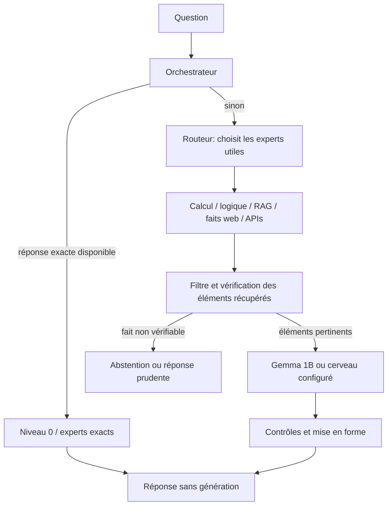

# Comment RontoGPT traite une demande

Ce document décrit le chemin réel d'une demande et le contenu du paquet `.aef`.
Les chiffres de qualité sont des mesures locales du projet, pas une promesse de
résultat pour toute question ni toute machine.

## Une demande, du début à la fin

1. L'orchestrateur traite d'abord les réponses constantes, les demandes de
   recopie et les solveurs exacts. Cela évite d'appeler le modèle pour des
   tâches qu'un calcul ou une règle résout sans ambiguïté.
2. Si aucun chemin exact ne répond, le routeur classe la demande et sélectionne
   les experts pertinents. Les tâches web, calcul et API publiques peuvent
   tourner en parallèle. Un expert en erreur ne bloque pas les autres.
3. Les faits récupérés sont filtrés avant d'être ajoutés au contexte. Le modèle
   sert à comprendre, expliquer et rédiger; un contrôle déterministe ou une
   source externe est préféré pour les résultats vérifiables.
4. Le modèle local produit la réponse quand une synthèse est nécessaire. Des
   contrôles bornent certains formats, refus et réponses douteuses. Si un fait
   demandé ne peut pas être ancré, RontoGPT peut s'abstenir plutôt que l'inventer.

Ce schéma résume le chemin principal : des requêtes spéciales (historique,
lecture de fichier, mémoire de conversation, recherche web) ont leurs propres
branches. Le routeur ne garantit pas la justesse d'une interprétation; la
qualité dépend aussi de la couverture des experts et des données.

## Continuité, recherche et apprentissage

- Au lancement, `MemoireConversation` recharge au plus les derniers tours de
  la fenêtre configurée depuis son journal JSONL. Le prompt reste borné ; le
  journal complet demeure consultable avec l'outil d'historique.
- La recherche web utilise DDGS par défaut. Si `AURA_GEMINI_API_KEY` est
  définie, RontoGPT essaie d'abord l'API Gemini avec l'outil Google Search, puis
  retombe sur DDGS si l'appel échoue. Les résultats transportent le titre,
  l'extrait et l'URL ; les URLs sont conservées après compression et ajoutées
  comme citations à la réponse. Une citation indique la provenance, pas la
  validation indépendante de la page.
- Les extraits et synthèses web sont traités comme données non fiables : le
  modèle local reçoit l'instruction d'ignorer les consignes intégrées aux
  pages et de signaler les preuves absentes ou contradictoires.
- Les corrections explicites peuvent être ajoutées via `enregistrer_correction`
  ou `/v1/learn`; elles alimentent un RAG de corrections et ne réentraînent pas
  les poids. Une révision web n'est consolidée dans le cache et le graphe que
  si elle change la réponse et porte au moins deux URLs distinctes. Ce seuil
  réduit les apprentissages fragiles, sans garantir la vérité des sources.

## Ce que le paquet `.aef` fait exactement

1. La forge choisit le GGUF selon `AURA_GGUF_CHEMIN`, puis
   `AURA_GGUF`, puis `[llama].chemin`/`[llama].gguf` dans `aura.toml`.
2. Elle met dans le fichier un en-tête de 148 octets, une configuration LZMA,
   le code `aura/` en ZIP et les poids GGUF bruts. Les sections sont hachées.
3. Au premier démarrage, le kernel vérifie le fichier et extrait code et poids
   dans `.cache_aef/`. `llama.cpp` charge le GGUF extrait. Le paquet reste
   présent : le cache et le `.aef` prennent donc chacun environ la taille des
   poids. Le cache rapide vérifie aussi l'identité du GGUF, pas seulement sa
   taille.
4. Le modèle embarqué est prioritaire au démarrage. Sur un matériel différent
   de la machine de forge, le kernel active l'auto-réglage local, sauf si
   `AURA_TUNING` a été explicitement défini.

Le format n'est pas une compression de modèle. Le Gemma actuellement mesuré
occupe environ 806 Mo. Le R1 Distill 1,5B Q4_K_M pèse environ 1,12 Go : il peut
être mis dans un `.aef`, mais dépasse déjà la cible de stockage stricte de 1 Go,
avant même le cache extrait. Les poids Q4 sont peu compressibles.

Avant le chargement, RontoGPT estime une mémoire de travail égale à 2,2 fois la
taille du GGUF et la compare à 45 % de la RAM détectée. C'est une barrière
prudente contre un manque de mémoire, pas une mesure exacte du pic réel. Le
profil courant règle notamment le contexte à 4096 tokens et le batch à 768
au-delà de 6 Go de RAM; sous ce seuil, il choisit 1024 et 512.

## Puissance mesurée et limites

Le dernier banc propre de 100 questions pour Gemma donne **94/100**, dont
85/85 sur le sous-ensemble vérifiable et 9/15 en forme, en 348 secondes. Il
mesure la chaîne complète (règles, outils, récupération et modèle), pas le
modèle seul. Le banc précédent pouvait réutiliser l'historique réel et son
98/100 n'est donc pas comparable. Le parseur corrigé fait passer la catégorie
`format` à 5/5; les garde-fous RAG réussissent aussi un jeu pilote séparé de
23 questions. Les rédactions ne sont conformes que dans 4 cas sur 10 et restent
variables. Voir [la référence avec protocole et limites](BASELINE_2026-10-11.md).

Les mesures de génération relevées dans le projet pour Gemma sont 13,6 à
15,9 tokens/s, selon la mesure et le chemin d'exécution. Ce débit ne résume pas
la latence complète : chargement, recherche, raisonnement et longueur de sortie
s'y ajoutent. Le R1 1,5B a résolu un exemple GSM8K que Gemma ratait, mais la note
locale rapporte 51 à 66 secondes pour un problème difficile avec le profil
allégé (et 155 secondes avec le profil complet). Ces mesures ne suffisent pas
à conclure qu'il est globalement meilleur; ses adaptateurs Gemma ne sont pas
compatibles.

Le score de banc ne mesure ni la robustesse sur toutes les langues et tous les
sujets, ni la qualité créative, ni les hallucinations dans tous les cas. Pour
comparer une évolution, conserver le même jeu, la même machine et les mêmes
réglages, puis mesurer qualité, taux d'abstention, latence médiane/p90, RAM et
espace disque. Aucun multiplicateur global de puissance ne peut être déduit du
seul score du banc.
